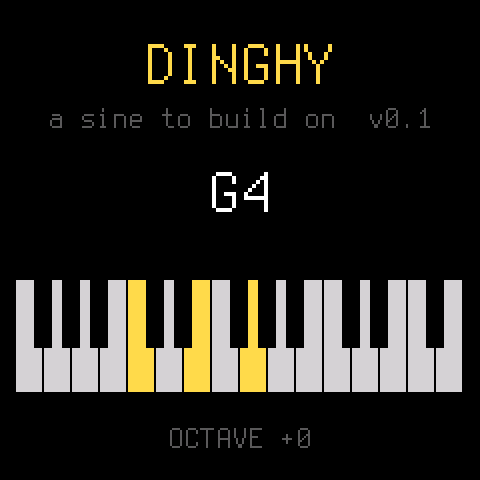

<p align="center"></p>

# Dinghy

**The smallest firmware for the M-VAVE FM-1 to build your own on.**

Dinghy plays a sine wave on the keys, and that is all it does. Under it is everything an FM-1 firmware needs
before it can be any fun: the update path, the USB rescue, USB-MIDI, USB audio, the keys, knobs and LEDs, the
screen and a place to keep settings. It all works, so you start with the part you actually want to write.

```
firmware/src/dinghy.c     <- your firmware: ~200 lines, a 4-voice sine. Start here.
firmware/src/platform.c   <- the plumbing (boot, USB, updates, audio ISR, settings). Done; read it, don't fight it.
firmware/src/*.c, hal/    <- the platform of SLOOP / Felucca, unchanged
```

It is the bottom of a family of boats: [Felucca](https://github.com/hugelton/Felucca) by Leo Kuroshita
(Hügelton Instruments), [SLOOP](https://github.com/isod89/sloop-fm1) on it, sloopDX and
[zp12](https://github.com/zvenson/zp12) on SLOOP. Dinghy keeps their platform and throws away the rest.

<p align="center"></p>

> **Status: 0.1, runs on the FM-1.** Tested on the device: the install, MIDI in (pitch exact, 4 voices), USB audio
> at 44.1 / 48 kHz, the keys, the screen, the octave kept in flash, and back to another firmware through the hub.

## What you get

| | |
| --- | --- |
| **Updates that always work** | `tools/fm1_install.py`, the web installers and the [FM-1 Firmware Hub](https://fm1.designburgapps.com) reach your firmware over USB, so you (and your users) can always install the next build, or go back to the official firmware. |
| **USB rescue** | Hold **OCT-** while switching on: no sound, only the updater. If your firmware crashes twice at boot, the FM-1 goes there by itself. |
| **USB-MIDI** | In and out, class compliant: `midi_get()`, `midi_send()`. |
| **USB audio** | The FM-1 shows up as a 16-bit stereo audio input (44.1 or 48 kHz): record it into any DAW or phone. Nothing to do. |
| **Panel** | 27 keys, 14 buttons, 7 encoders, the MASTER knob, the LEDs, by name (`BTN_PLAY`, `ENC_KNOB1`, ...). |
| **Screen** | 240 x 240, text in two sizes, rectangles, lines, pixels. |
| **Settings** | `settings_load()` / `settings_save()`: up to 256 bytes with a CRC in their own flash sector. |
| **A crash screen** | A fault shows where it happened (the PC), then the FM-1 restarts. |
| **Host mode** | The same `dinghy.c` on your computer: the screen as an image, the sound as a WAV. No FM-1 needed to try an idea. |
| **Checks** | The build fails on what bricks or breaks an FM-1 firmware: a 64-bit division, a call into the chip ROM, too much RAM, a register touched outside `hal/`. |

## Quick start

You need Linux on x86-64 (or macOS / Windows with Docker or WSL), Python 3 with Pillow, the JieLi toolchain
and three files of the JieLi AC79 SDK. Once:

```sh
pip3 install Pillow
tools/get_toolchain.sh                      # JieLi's clang for the chip, to ~/.jieli/toolchain
git clone --depth 1 --branch AC79NN_SDK_V1.2.1_2023-12-13 \
    https://gitee.com/Jieli-Tech/fw-AC79_AIoT_SDK.git ~/fw-AC79_AIoT_SDK
```

Then:

```sh
./build.sh                                  # -> build/dinghy.fwsc
tests/run_host.sh                           # -> build/host/dinghy.wav and screen PNGs, no FM-1 needed
```

On macOS the build runs the toolchain in a `linux/amd64` Docker container by itself (have Docker running).
`JIELI_TOOLCHAIN` and `AC79_SDK` point elsewhere if your copies live somewhere else.

**Install** your build over USB from the command line (once: `pip3 install mido python-rtmidi`):

```sh
python3 tools/fm1_install.py build/dinghy.fwsc   # asks before it writes; restarts the FM-1 into Dinghy
python3 tools/fm1_install.py --info              # what runs on the connected FM-1
```

Back to another firmware, or to the official one, with the [FM-1 Firmware Hub](https://fm1.designburgapps.com)
in Chrome or Edge: Dinghy answers the hub's updater like every firmware there. Installing firmware is at your own
risk.

## Your first change

Open [firmware/src/dinghy.c](firmware/src/dinghy.c). The sound is `app_audio()`: it gets an empty buffer of
stereo frames and adds to it. Make the sine a square:

```c
s = ((int32_t)ph < 0 ? 8000 : -8000) * amp >> 15;     /* instead of s = (sine(ph) * amp) >> 15; */
```

`tests/run_host.sh` and listen to `build/host/dinghy.wav`. Then `./build.sh` and install. That is the whole loop.

## Where to go next

- **[docs/API.md](docs/API.md)**: everything `platform.c` gives you, with the panel's ids, the screen calls, the
  audio contract, MIDI, settings, the flash map, timing.
- **[docs/MAKE-IT-YOURS.md](docs/MAKE-IT-YOURS.md)**: turn Dinghy into your firmware: the name, the package
  identity, releases, getting into the FM-1 Firmware Hub.
- **[docs/RULES.md](docs/RULES.md)**: the chip's rules (no FPU, no libgcc, the audio ISR's budget) and what the build
  checks for you. Read it before your first crash, not after.

## License

GPL-3.0-only, as Felucca and SLOOP: you may change and share it, and whoever gets your firmware gets its source.
Details, credits and third-party parts in [LICENSING.md](LICENSING.md).

The platform is Copyright (C) 2026 Leo Kuroshita (@kurogedelic), Hügelton Instruments, with SLOOP's and
sloopDX's changes. Dinghy (the app, the host mode, the docs) by zvenson.
