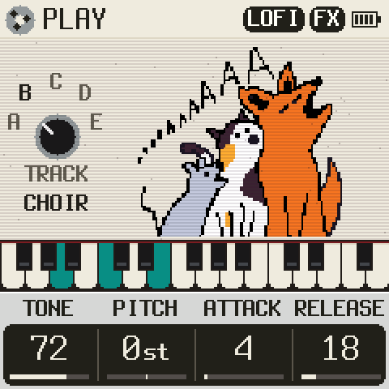
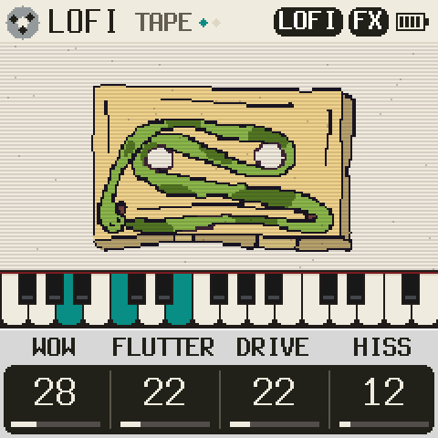

# FMEL-1

 

This is a personal project to create a few sounds I'm interested in for the M-VAVE FM-1.

## What is this?
This firmware, based on [zvenson's dinghy](https://github.com/zvenson/dinghy), aims to reproduce Mellotron sounds and
color them with some basic FX and lo-fi tape effects. It also lets you mix two different Mellotron sounds together.

**[Try it in your browser](https://antonioaltea.github.io/fmel-1/)**: the same code the FM-1 runs, in a simulator.
To put it on your FM-1, use the [web installer](https://antonioaltea.github.io/fmel-1/install/) (Chrome or Edge) or
download the newest [release](https://github.com/AntonioAltea/fmel-1/releases/latest).

## Disclaimer

This is a hobby project, not an official M-VAVE thing. Install at your own risk, no warranty. If something goes wrong,
the installer's "If something goes wrong" section shows how to get back to the official firmware.

## The tapes

FMEL-1 plays real Mellotron tapes: the samples Bernie Kornowicz (Taijiguy) recorded from his 1973 Mellotron M400S,
serial #500, with new tapes and frames, and shared on his site [leisureland.us](http://leisureland.us).

They are his work, not mine, and not under this repository's GPL licence. His terms, in his own words
([KVR, 4 May 2021](https://www.kvraudio.com/forum/viewtopic.php?t=561309)): "they are free to use, but cannot be used
in any commercial, for profit software." FMEL-1 is free and not for profit, so it carries them: packed for the FM-1
(IMA ADPCM at 11025 Hz, a few seconds of each) in `firmware/gen/mel_tapes.h`, and so inside every build (`mel.fwsc`,
the web version).

So: share FMEL-1 freely, but don't sell it, nor anything with these tapes in it. Thank you, Bernie.

The fifth sound, PIANO, is not a Mellotron tape: it is [SLOOP](https://github.com/isod89/sloop-fm1)'s LOFI KEYS, its
four keys of a Steinway B from Versilian Studios' [VCSL](https://github.com/sgossner/VCSL) (public domain, CC0) made
and played as SLOOP makes and plays them (an octave up from the keys; 1 s of each at 22050 Hz, looped; a few bits off, a little drive, a gentle
low-pass, a 2.5 s decay and a slow pitch wobble); about 44 KB.

To pack the tapes again (another selection, other lengths), fetch his originals (from his old site, via the Wayback
Machine) and run the packer:

    tools/get_tapes.sh                                  # into tapes/, which git ignores
    tools/get_piano.sh                                  # the piano (SLOOP's), also into tapes/
    tools/gen_tapes.py firmware/gen/mel_tapes.h

## Credits

- Drawings by my friend Javi
- [Dinghy](https://github.com/zvenson/dinghy) by zvenson: the firmware FMEL-1 grew out of
- [Felucca](https://github.com/hugelton/Felucca) by Leo Kuroshita (@kurogedelic), Hügelton Instruments: the FM-1
  platform underneath
- [SLOOP](https://github.com/isod89/sloop-fm1) by isod89: its changes to that platform
- [FM-1-transporter](https://github.com/kurogedelic/FM-1-transporter) by Leo Kuroshita: the rescue, if an update goes
  wrong
- The Mellotron M400S tapes by Bernie Kornowicz (Taijiguy), from his site <http://leisureland.us> (see above)
- The browser version follows the emulators of X0X, Felucca and FoMni
- The EQ: Felucca's SPEAKER EQ (FLAT, LOWCUT, BASS+), as it is there
- The reverbs: HALL after Felucca's, PLATE Jon Dattorro's after FoMni's (Charles Vestal)
- SELECT as the hand on the tape's reel: the idea is GHOULBOX's crank (jasonpersinger, [ghoulbox-fm1-dungeon-synth](https://github.com/jasonpersinger/ghoulbox-fm1-dungeon-synth))
- [Terminus](https://terminus-font.sourceforge.net) by Dimitar Zhekov: the screen's font (SIL OFL 1.1)
- [JieLi AC79 SDK](https://gitee.com/Jieli-Tech/fw-AC79_AIoT_SDK): the boot files a build is packaged with
