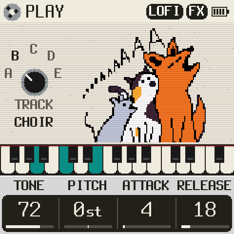
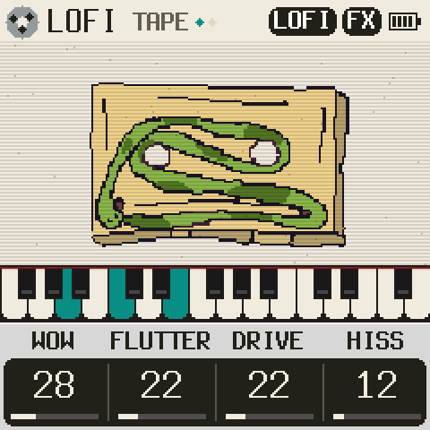

# FMEL-1

 

This is a personal project to create a few sounds I'm interested in for the M-VAVE FM-1 and SMK-37.

## What is this?
This firmware, based on [zvenson's dinghy](https://github.com/zvenson/dinghy), aims to reproduce Mellotron sounds and
color them with some basic FX and lo-fi tape effects. It also lets you mix two different Mellotron sounds together.

**[Try it in your browser](https://antonioaltea.github.io/fmel-1/)**: the same code the keyboard runs, in a simulator
(FM-1 or SMK-37). To install it, use the [web installer](https://antonioaltea.github.io/fmel-1/install/) (Chrome or
Edge; FM-1 or SMK-37) or download the newest [release](https://github.com/AntonioAltea/fmel-1/releases/latest).

It runs on the M-Vave FM-1 and the SMK-37 (Pro, Elite, MKE-P37). SMK-37 controls: [SMK37.md](SMK37.md).

## Sounds

A FLUTE, B CHOIR, C CELLO, D VIBES, E SAX: Mellotron M400S tapes. F PIANO: a Steinway B.

## New in 1.3

- Newer FM-1s with the UC25HQ80 flash chip (0xB36014) save settings and patterns to flash. Before, they kept them in RAM only, and lost them on power off. From Dinghy 0.5.

## New in 1.2

- FLUTE: 1.0's again: its 12 tapes in IMA ADPCM, each key its own level, no low-pass. With LOFI and FX out, it plays as 1.0 to the sample. (1.1's had a whoosh at the start of its low notes.)
- SAX: 8-bit PCM, now packed without loss: the same sound in 30 KB less.

## New in 1.1

- E SAX: Taijiguy's tenor sax tape. PIANO moves to F; saved settings follow it.
- PIANO: VCSL's samples played clean (was SLOOP's LOFI KEYS).
- SMK-37 support: 37 velocity keys, pads, faders, wheels, pedal.
- SETUP > VELOCITY (SMK-37): how far the softest note drops. 0%: 0 dB. 50%: -20 dB. 100%: -40 dB.
- Mod wheel (SMK-37, or MIDI CC 1): vibrato DEPTH, from the page's value to 100%, and its MIX to fully wet.
- OCT- and OCT+ held 5 s: restart into USB rescue mode.
- Tapes in block ADPCM (genkigenki's Erik37 format). Flute and sax in 8-bit PCM.
- Installer and simulator: FM-1 / SMK-37 selector.
- REC held 1 s clears the pattern (was SEL held, in step recording).
- SEQ steps play at full level (SMK-37); playing over them does not change it.
- AGE adds no hiss. HISS is the only hiss control.

## Disclaimer

This is a hobby project, not an official M-VAVE thing. Install at your own risk. If something goes wrong,
the installer's "If something goes wrong" section shows how to get back to the official firmware. Holding OCT- and
OCT+ for 5 s restarts the keyboard into USB rescue mode.

## The tapes

FMEL-1 plays real Mellotron tapes: the samples Bernie Kornowicz (Taijiguy) recorded from his 1973 Mellotron M400S,
serial #500, with new tapes and frames, and shared on his site [leisureland.us](https://web.archive.org/web/2023/http://leisureland.us/) (via the Wayback Machine).

They are his work, not mine, and not under this repository's GPL licence. His terms, in his own words
([KVR, 4 May 2021](https://www.kvraudio.com/forum/viewtopic.php?t=561309)): "they are free to use, but cannot be used
in any commercial, for profit software." FMEL-1 is free and not for profit, so it carries them: packed at 11025 Hz,
a few seconds of each, as block ADPCM in genkigenki's [Erik37](https://github.com/genkigenki/erik37) format (the flute
as IMA ADPCM, the sax as packed 8-bit PCM) in `firmware/gen/mel_tapes.h`, and so inside every build (`mel*.fwsc`, the web version).

So: share FMEL-1 freely, but don't sell it, nor anything with these tapes in it. Thank you, Bernie.

The sixth sound, F PIANO, is not a Mellotron tape: it is four keys of a Steinway B from Versilian Studios'
[VCSL](https://github.com/sgossner/VCSL) (public domain, CC0), as [SLOOP](https://github.com/isod89/sloop-fm1) cut
them, played clean: an octave up from the keys, 1 s of each at 22050 Hz as 8-bit PCM (cleaner than the tapes' ADPCM), each
key's own decay going on as it rings; about 88 KB.

To pack the tapes again (another selection, other lengths), fetch his originals (from his old site, via the Wayback
Machine) and run the packer:

    tools/get_tapes.sh                                  # into tapes/, which git ignores
    tools/get_piano.sh                                  # the piano (SLOOP's), also into tapes/
    tools/gen_tapes.py firmware/gen/mel_tapes.h

## Credits

- Drawings by my friend Javi
- [Dinghy](https://github.com/zvenson/dinghy) by zvenson: the firmware FMEL-1 grew out of
- genkigenki: the SMK-37 board layer ([fm1-to-smk37](https://github.com/genkigenki/fm1-to-smk37)), the first SMK-37
  build of FMEL-1, the tapes' block ADPCM ([Erik37](https://github.com/genkigenki/erik37))
- [Felucca](https://github.com/hugelton/Felucca) by Leo Kuroshita (@kurogedelic), Hügelton Instruments: the FM-1
  platform underneath
- [SLOOP](https://github.com/isod89/sloop-fm1) by isod89: its changes to that platform
- [FM-1-transporter](https://github.com/kurogedelic/FM-1-transporter) by Leo Kuroshita: the rescue, if an update goes
  wrong
- The Mellotron M400S tapes by Bernie Kornowicz (Taijiguy), from his site [leisureland.us](https://web.archive.org/web/2023/http://leisureland.us/) (via the Wayback Machine) (see above)
- The browser version follows the emulators of X0X, Felucca and FoMni
- The EQ: Felucca's SPEAKER EQ (FLAT, LOWCUT, BASS+), as it is there
- The reverbs: HALL after Felucca's, PLATE Jon Dattorro's after FoMni's (Charles Vestal)
- SELECT as the hand on the tape's reel: the idea is GHOULBOX's crank (jasonpersinger, [ghoulbox-fm1-dungeon-synth](https://github.com/jasonpersinger/ghoulbox-fm1-dungeon-synth))
- [Terminus](https://terminus-font.sourceforge.net) by Dimitar Zhekov: the screen's font (SIL OFL 1.1)
- [JieLi AC79 SDK](https://gitee.com/Jieli-Tech/fw-AC79_AIoT_SDK): the boot files a build is packaged with
